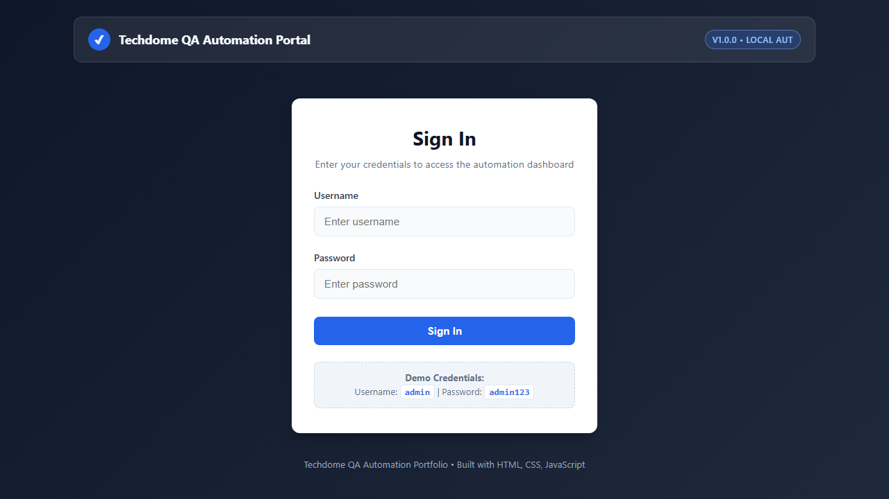
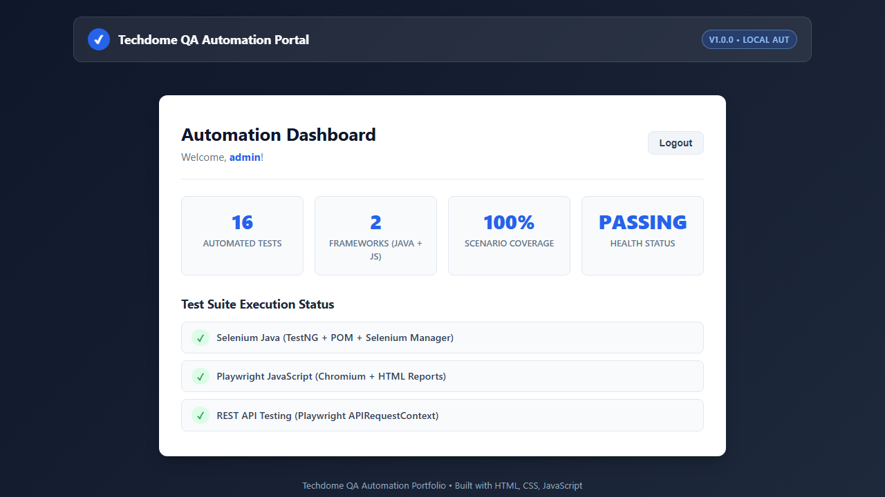

# Techdome QA Automation Engineering Portfolio

[](#sample-test-execution-results)
[](https://www.selenium.dev/)
[](https://testng.org/)
[](https://playwright.dev/)
[](https://adoptium.net/)
[](https://nodejs.org/)

A production-grade, interview-ready QA Test Automation portfolio designed specifically for the **Quality Assurance Engineer Intern** position at **Techdome Solutions**. 

This repository contains fully working, verified, and cross-framework automated test suites testing a realistic client-side web application alongside external REST API endpoints.

---

## 1. Project Objectives

- **Demonstrate Industry-Standard UI Automation:** Implement robust UI tests using enterprise **Selenium WebDriver 4 with Java** and modern **Playwright with JavaScript**.
- **Demonstrate Page Object Model (POM):** Decouple UI locators and page interactions from test business logic for long-term maintainability.
- **Eliminate Automation Anti-Patterns:** Strictly enforce explicit waits (`WebDriverWait` and Playwright auto-waiting) to avoid brittle `Thread.sleep()` or arbitrary timeouts.
- **REST API Automation:** Showcase end-to-end API test automation using Playwright's native `APIRequestContext`.
- **Automated Diagnostics:** Implement automated test listeners that capture failure screenshots on demand.
- **Execution Portability:** Ensure tests execute seamlessly across platforms with single-command runners for Windows PowerShell, macOS, and Linux.

---

## 2. Technology Stack

### Selenium Automation (Java)
- **Language:** Java 17+ (Temurin OpenJDK)
- **Core Library:** Selenium WebDriver 4.26.0
- **Test Runner:** TestNG 7.10.2
- **Build & Dependency Tool:** Apache Maven
- **Driver Management:** Native Selenium Manager (built-in automated driver resolution)
- **Design Pattern:** Page Object Model (POM) + TestNG `ITestListener`

### Playwright Automation (JavaScript)
- **Language:** JavaScript (Node.js ES6+ / CommonJS)
- **Core Framework:** `@playwright/test` 1.49+
- **Target Browser:** Chromium
- **API Engine:** Playwright `APIRequestContext`
- **Reporting Engine:** Playwright HTML Reporter + Trace Viewer

### Application Under Test (AUT)
- **Stack:** HTML5, CSS3, Modern JavaScript (ES6)
- **Architecture:** Local single-page application requiring zero external server or database setup
- **Accessibility:** Accessible ARIA roles, semantic markup, and reliable `id` / `data-testid` selectors

---

## 3. Repository Structure

```
Techdome-QA-Automation-Portfolio/
│
├── application/                         # Application Under Test (AUT)
│   ├── index.html                       # Semantic, accessible UI layout
│   ├── style.css                        # Modern, responsive stylesheet
│   └── script.js                        # Client-side auth, validation & session logic
│
├── selenium-java/                       # Selenium Java Test Framework
│   ├── pom.xml                          # Maven build configuration
│   └── src/
│       └── test/
│           ├── java/
│           │   ├── base/
│           │   │   └── BaseTest.java    # Driver lifecycle & Selenium Manager config
│           │   ├── pages/
│           │   │   └── LoginPage.java   # Page Object Model implementation
│           │   ├── tests/
│           │   │   └── LoginTest.java   # 8 TestNG test scenarios
│           │   └── utils/
│           │       └── TestListener.java# TestNG failure listener & screenshot capture
│           └── resources/
│               └── testng.xml           # TestNG suite suite definition
│
├── playwright-javascript/               # Playwright JavaScript Framework
│   ├── package.json                     # npm dependencies and scripts
│   ├── playwright.config.js             # Chromium & HTML reporter config
│   └── tests/
│       ├── login.spec.js                # 8 Playwright E2E UI scenarios
│       └── api.spec.js                  # 4 REST API test scenarios
│
├── docs/                                # Professional QA Documentation
│   ├── test-cases.md                    # Detailed Test Case Specification
│   ├── testing-strategy.md              # Testing pyramid, smoke/regression plans
│   └── project-architecture.md          # Architecture diagrams & component design
│
├── screenshots/                         # Showcase images & automated failure captures
│   ├── login-page.png                   # Application login view snapshot
│   ├── dashboard-page.png               # Application dashboard view snapshot
│   └── .gitkeep
│
├── run-all.ps1                          # PowerShell runner for complete suite (Selenium + Playwright)
├── run-selenium.ps1                     # PowerShell runner for Selenium suite
├── run-playwright.ps1                   # PowerShell runner for Playwright suite
├── .gitignore                           # Clean Git ignore rules
└── README.md                            # Comprehensive project guide
```

---

## 4. Application Showcase

The Application Under Test is a responsive, professional QA portal featuring authentication, client-side input validation, an interactive metrics dashboard, and session logout handling.

### Login Screen


### Dashboard Screen (Post-Authentication)


### Demo Credentials
- **Username:** `admin`
- **Password:** `admin123`

---

## 5. Test Scenarios Covered

Both frameworks (Selenium Java and Playwright JavaScript) execute identical assertions against the same application to guarantee parity across toolsets:

| Test ID | Scenario Description | Input Data | Expected Result | Status |
| :---: | :--- | :--- | :--- | :---: |
| **TC01** | Successful Login | `admin` / `admin123` | Dashboard visible, greeting `"Welcome, admin!"`, login form hidden | **PASS** |
| **TC02** | Invalid Password | `admin` / `wrongpassword` | Error alert: `"Invalid username or password."` | **PASS** |
| **TC03** | Invalid Username | `wronguser` / `admin123` | Error alert: `"Invalid username or password."` | **PASS** |
| **TC04** | Empty Username | `""` / `admin123` | Validation alert: `"Username is required."` | **PASS** |
| **TC05** | Empty Password | `admin` / `""` | Validation alert: `"Password is required."` | **PASS** |
| **TC06** | Both Fields Empty | `""` / `""` | Validation alert: `"Please fill in all fields."` | **PASS** |
| **TC07** | Dashboard Visibility | `admin` / `admin123` | All 4 metric cards and logout button rendered | **PASS** |
| **TC08** | Logout Functionality | Authenticated session | Session terminated, login form reappears, success banner displayed | **PASS** |

### Additional REST API Scenarios (Playwright)
| API ID | Method | Endpoint / Scope | Validations | Status |
| :---: | :---: | :--- | :--- | :---: |
| **API-01** | `GET` | `/posts/1` | Status 200, JSON schema, data integrity | **PASS** |
| **API-02** | `GET` | `/posts?userId=1` | Status 200, Query filtering, non-empty array | **PASS** |
| **API-03** | `POST` | `/posts` | Status 201 Created, ID returned, payload echoed | **PASS** |
| **API-04** | `GET` | `/posts/99999` (Negative) | Status 404 Not Found, empty response body | **PASS** |

---

## 6. Setup & Installation Guide

### Prerequisites
1. **Java Development Kit (JDK):** Version 17 or higher (`java -version`).
2. **Apache Maven:** Version 3.8+ (`mvn -v`).
3. **Node.js & npm:** Node 18+ or 22+ (`node -v` and `npm -v`).
4. **Google Chrome:** Installed on machine.

### Installation Steps

#### 1. Clone the repository
```bash
git clone <repository-url>
cd qa-automation-portfolio
```

#### 2. Install Playwright Dependencies & Browsers
```powershell
cd playwright-javascript
npm install
npx playwright install chromium
cd ..
```

---

## 7. Execution Commands

### Option A: Run Everything with One Command (Windows PowerShell)

Run both Selenium and Playwright test suites in one go:
```powershell
.\run-all.ps1
```

Or run suites individually via helper scripts:
```powershell
.\run-selenium.ps1
.\run-playwright.ps1
```

---

### Option B: Manual Execution via CLI

#### 1. Selenium Java (TestNG)
Navigate to the `selenium-java` directory and run Maven:

```powershell
# Windows PowerShell
cd selenium-java
mvn clean test
```

*Headless execution is enabled by default. To run in headed mode:*
```powershell
mvn test -Dheadless=false
```

#### 2. Playwright JavaScript
Navigate to the `playwright-javascript` directory:

```powershell
# Run all tests (UI + API)
cd playwright-javascript
npm test

# Run only UI tests
npm run test:ui

# Run only API tests
npm run test:api

# Run tests in headed browser mode
npm run test:headed
```

---

## 8. Test Reports & Diagnostics

### Viewing Playwright HTML Reports
After executing Playwright tests, launch the interactive HTML report:
```powershell
cd playwright-javascript
npm run report
```
The report opens automatically in your default browser, providing test step timelines, execution duration, and DOM screenshots.

### Viewing TestNG / Surefire Reports
After executing Maven tests, view the Surefire test report generated at:
```
selenium-java/target/surefire-reports/index.html
selenium-java/target/surefire-reports/emailable-report.html
```

### Automated Failure Screenshots
Both frameworks automatically capture viewport screenshots on failure:
- **Selenium:** Handled by `TestListener.java` implementing `ITestListener.onTestFailure`, saving files to `/screenshots/FAIL_<testName>_<timestamp>.png`.
- **Playwright:** Configured in `playwright.config.js` (`screenshot: 'only-on-failure'`).

---

## 9. Sample Test Execution Results

### Selenium Java TestNG Run
```text
=======================================================
T E S T S
=======================================================
Running TestSuite
========== Starting Suite: Login Functionality Tests ==========
[STARTED] Executing Test: testBothFieldsEmpty
[PASSED]  Test Passed: testBothFieldsEmpty
[STARTED] Executing Test: testDashboardVisibilityAfterLogin
[PASSED]  Test Passed: testDashboardVisibilityAfterLogin
[STARTED] Executing Test: testEmptyPassword
[PASSED]  Test Passed: testEmptyPassword
[STARTED] Executing Test: testEmptyUsername
[PASSED]  Test Passed: testEmptyUsername
[STARTED] Executing Test: testInvalidPassword
[PASSED]  Test Passed: testInvalidPassword
[STARTED] Executing Test: testInvalidUsername
[PASSED]  Test Passed: testInvalidUsername
[STARTED] Executing Test: testLogoutFunctionality
[PASSED]  Test Passed: testLogoutFunctionality
[STARTED] Executing Test: testSuccessfulLogin
[PASSED]  Test Passed: testSuccessfulLogin
========== Finished Suite: Login Functionality Tests ==========

Results:
Tests run: 8, Failures: 0, Errors: 0, Skipped: 0
[INFO] BUILD SUCCESS
```

### Playwright JavaScript Run
```text
Running 12 tests using 1 worker

  ok  1 [chromium] › tests\api.spec.js:19:3 › REST API Automation › API-01: GET /posts/1 (787ms)
  ok  2 [chromium] › tests\api.spec.js:39:3 › REST API Automation › API-02: GET /posts?userId=1 (748ms)
  ok  3 [chromium] › tests\api.spec.js:61:3 › REST API Automation › API-03: POST /posts (979ms)
  ok  4 [chromium] › tests\api.spec.js:86:3 › REST API Automation › API-04: Negative Test - 404 (697ms)
  ok  5 [chromium] › tests\login.spec.js:50:3 › Login Suite › TC01 - Successful login (1.0s)
  ok  6 [chromium] › tests\login.spec.js:68:3 › Login Suite › TC02 - Invalid password (707ms)
  ok  7 [chromium] › tests\login.spec.js:82:3 › Login Suite › TC03 - Invalid username (761ms)
  ok  8 [chromium] › tests\login.spec.js:94:3 › Login Suite › TC04 - Empty username (749ms)
  ok  9 [chromium] › tests\login.spec.js:106:3 › Login Suite › TC05 - Empty password (742ms)
  ok 10 [chromium] › tests\login.spec.js:118:3 › Login Suite › TC06 - Both fields empty (692ms)
  ok 11 [chromium] › tests\login.spec.js:129:3 › Login Suite › TC07 - Dashboard metrics visibility (816ms)
  ok 12 [chromium] › tests\login.spec.js:147:3 › Login Suite › TC08 - Logout functionality (931ms)

  12 passed (11.3s)
```

---

## 10. QA Engineering Skills Demonstrated

| Core Competency | Demonstrated In |
| :--- | :--- |
| **Object-Oriented Automation** | Encapsulated Page Object Model (`LoginPage.java`) with Java 17+ and TestNG |
| **Modern Event-Driven Automation** | Playwright Test with async/await, resilient role-based locators, auto-waiting |
| **API Testing** | JSON schema validation, HTTP response code checks (200, 201, 404), query params |
| **Synchronization Best Practices** | Dynamic explicit waits (`WebDriverWait`, `ExpectedConditions`); zero `Thread.sleep` |
| **Test Design & Documentation** | Positive, negative, edge cases, and testing strategy documents (`docs/`) |
| **Continuous Integration Readiness** | Fully headless capable, Maven Surefire integration, zero-config local AUT |

---

## 11. Techdome Solutions Interview Guide: How to Explain This Project

When discussing this project with the engineering team at Techdome Solutions:

1. **The Architecture:**
   > *"I structured this portfolio around a dual-framework architecture. I wanted to demonstrate competency in both enterprise Java with Selenium WebDriver 4 and modern asynchronous JavaScript with Playwright. Both frameworks test the exact same client-side application to prove consistency across automation paradigms."*

2. **Synchronization Strategy:**
   > *"A common mistake in beginner automation is relying on `Thread.sleep()`. In my Selenium framework, I strictly utilized explicit waits (`WebDriverWait`) targeting expected conditions like element visibility and clickability. In Playwright, I leveraged its built-in auto-waiting engine and role-based locators (`getByRole`), which make tests immune to race conditions."*

3. **Page Object Model (POM):**
   > *"In the Java framework, I decoupled page interactions from assertions. If an ID or CSS class in the login form changes tomorrow, I only update `LoginPage.java`, and none of my 8 test methods break."*

4. **API Testing Experience:**
   > *"Along with UI automation, I implemented automated REST API testing using Playwright's `APIRequestContext`. I tested GET requests with query parameters, verified HTTP status codes like 201 for POST operations and 404 for missing resources, and asserted JSON schema types."*

---

## 12. Future Enhancements

- [ ] Add cross-browser matrix execution (Firefox, WebKit/Safari, Edge).
- [ ] Implement GitHub Actions CI/CD pipeline running headless tests on every pull request.
- [ ] Integrate Allure reporting for enhanced visual diagnostics.
- [ ] Expand API testing suite to test mock JWT authentication headers.

