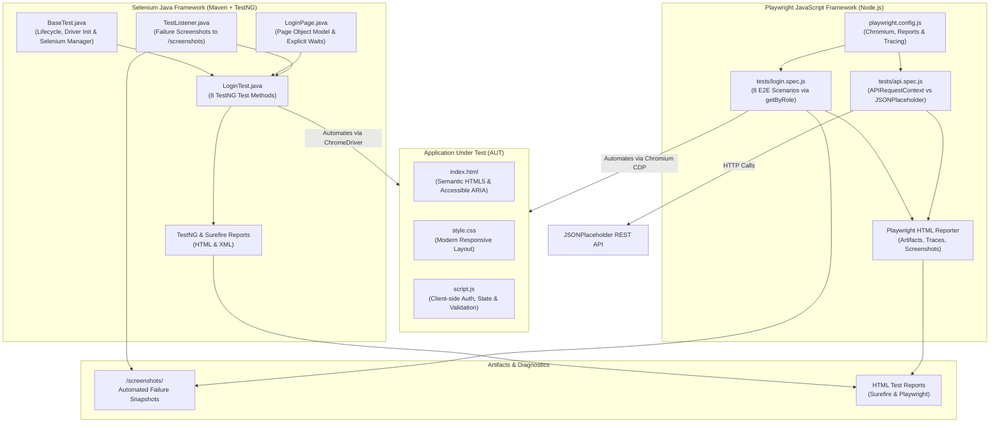
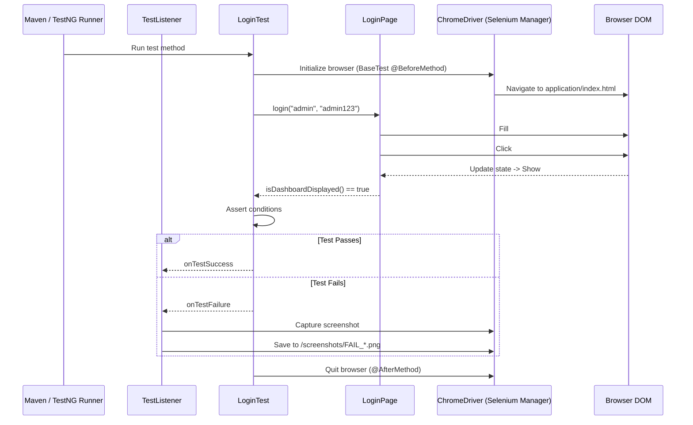

# Project Architecture & System Design

This document details the architectural design of the **Techdome QA Automation Portfolio**, illustrating how the Application Under Test (AUT), the Selenium Java framework, and the Playwright JavaScript framework interact.

---

## 1. High-Level Architecture Overview

---

## 2. Component Breakdown

### 2.1. Application Under Test (`/application`)
- **Technology:** Pure HTML5, CSS3, vanilla ES6 JavaScript.
- **Portability:** Works locally with zero backend dependencies, database setups, or remote network requirements.
- **Features:**
  - Login Card with stable locators (`#username`, `#password`, `#login-btn`, `#error-message`, `#success-message`).
  - Validation engine handling empty states, invalid credentials, and boundary checks.
  - Interactive Dashboard revealed dynamically upon valid credentials (`admin` / `admin123`).
  - Session termination handling via Logout button (`#logout-btn`).

---

### 2.2. Selenium Java Automation Framework (`/selenium-java`)
- **Language & Runtime:** Java 17+ (Temurin OpenJDK).
- **Frameworks:** Selenium WebDriver 4.26+, TestNG 7.10.2, Apache Maven.
- **Key Architectural Patterns:**
  - **Selenium Manager:** Native Selenium 4 driver resolution eliminates legacy manual driver downloads or external third-party dependencies (`webdrivermanager`).
  - **Page Object Model (POM):**
    - `LoginPage.java` encapsulates all UI locators (`By`) and user actions.
    - `LoginTest.java` contains purely assertions and test flows.
  - **Explicit Synchronization:** `WebDriverWait` paired with `ExpectedConditions` guarantees elements are interactive before dispatching events.
  - **Dynamic Failure Capture:** `TestListener` intercepts test execution lifecycle, saving timestamped screenshots to `/screenshots` whenever an assertion fails.

---

### 2.3. Playwright JavaScript Framework (`/playwright-javascript`)
- **Language & Runtime:** JavaScript (Node.js 18+ / 22+).
- **Test Runner:** `@playwright/test`.
- **Target Browser:** Chromium.
- **Key Architectural Features:**
  - **Role-Based Locators:** Replaces brittle CSS/XPath with accessible user-centric locators (`page.getByRole('button')`, `page.getByLabel('Username')`).
  - **Automatic Waiting:** Eliminates artificial sleep statements by waiting for actionability (visible, attached, stable, clickable).
  - **APIRequestContext:** Native HTTP client (`request`) executes REST API tests alongside UI tests with zero extra npm dependencies.
  - **Built-in HTML Reporter & Trace Viewer:** Comprehensive execution metrics, DOM snapshots, network logs, and failure screenshots.

---

## 3. Technology Comparison Matrix

| Architectural Dimension | Selenium Java | Playwright JavaScript |
| :--- | :--- | :--- |
| **Driver Management** | Selenium Manager (Automated) | Playwright Bundled Chromium |
| **Locator Strategy** | Page Object Model with `By` locators | User-facing (`getByRole`, `getByLabel`) |
| **Wait Strategy** | Explicit Waits (`WebDriverWait`) | Native Auto-Waiting |
| **Test Runner** | TestNG | Playwright Test Runner |
| **API Testing** | Requires RestAssured / HttpClient | Native `request` fixture |
| **Reporting** | Surefire Reports + TestNG HTML | Interactive Playwright HTML Report |
| **Language Target** | Enterprise Java 17+ | Asynchronous Modern JavaScript |

---

## 4. Execution Flow & Portability

The test suites are designed to be 100% self-contained:
1. Both frameworks resolve the application file path dynamically from the repo root or subfolder.
2. Selenium Manager automatically fetches compatible Chrome binaries on first run.
3. Playwright uses installed Chromium browser.
4. Windows PowerShell scripts and standard Maven/npm commands are provided for reproducible one-command runs.

